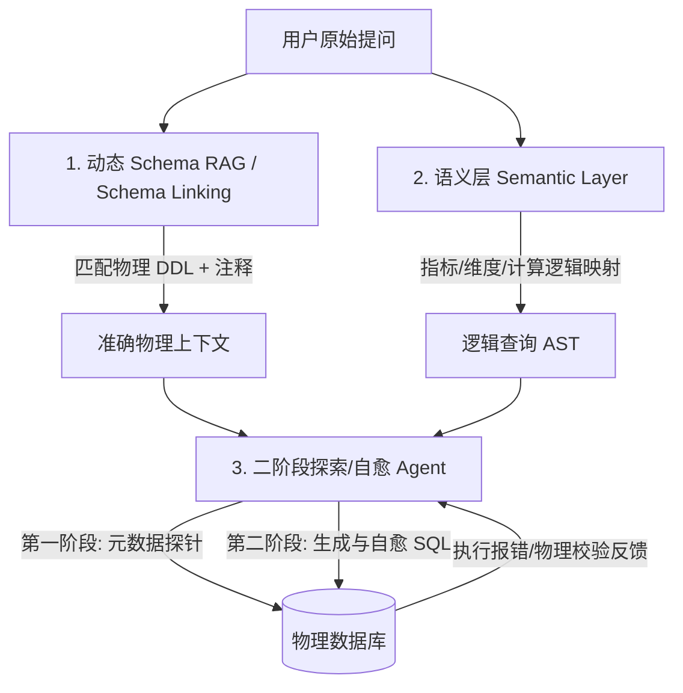
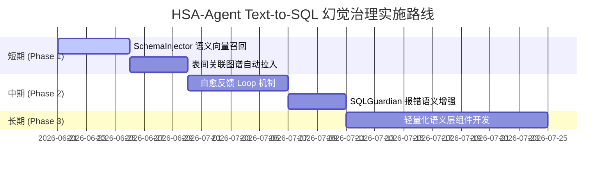

# 医疗保障基金智能稽核助手 (Argus-Agent)
## 企业级 Text-to-SQL 幻觉治理与架构优化方案

### 1. 背景与核心问题诊断
在 HSA 7-Dimension Benchmark 测试中，案例 `QA-NEW-07` (空间与时序交叉对碰 / Spatial Teleportation) 仅获得 31/70 的低分。其核心败因在于 Coder 智能体产生了解构性幻觉：
- **物理幻觉表/列**：生成了非物理存在的 `fixmedins_location` 表，以及 `latitude` (纬度) 和 `longitude` (经度) 字段，试图使用 `Haversine` 经纬度公式计算空间距离。
- **元数据阻断 (DDL Omission)**：`SceneTableSelector` 在匹配查询关键词时，由于仅识别出 `"门诊"` 关键词而强制指定 `fqz_fymx_test`，导致结算主记录表 `fqz_gz_jzsj_all_ql` 及其字段从 LLM 的 `<database_schema_context>` 中被剥离，大模型在信息缺失的情况下被迫进行“参数偏见猜测”。
- **物理校验与批判循环失效**：Critic 智能体指出了表名缺失，但 Coder 智能体在修改时虽然替换了主表，却依然执着于物理上不存在的 `latitude` 字段，导致二次物理拦截。
- **零发现探针限制**：过于刚性的“禁止前置探索”提示限制了智能体通过物理执行 `lookup_medical_schema` 等探针工具自愈的能力。

---

### 2. 行业标杆 (大厂) 的 Text-to-SQL 解决之道

针对复杂、动态的大规模数据库查询，大厂 (如蚂蚁集团、字节跳动、阿里巴巴) 在构建 Text-to-SQL 系统时，已不再依赖纯 prompt 提示或静态 Few-Shot 模板，而是采用以下三层核心工程架构：



#### 2.1 动态 Schema 路由与上下文链接 (Schema Linking & Routing RAG)
- **多模态匹配**：利用语义向量 (Embedding) 与词频 (BM25) 混合检索物理 DDL。大模型通过语义向量匹配“物理距离”，系统将自动召回“行政区划”和“统筹区”表 (`admdvs` / `fix_blng_admdvs`)，从物理层面解决 Schema 遗漏问题。
- **关系关联图谱**：维护表间关联外键的元数据图，当一张表被激活时，其关联的字典表与辅助表自动被拉入 Context。

#### 2.2 语义层隔离 (Semantic Layer / Headless BI)
- **业务逻辑与物理 SQL 解耦**：通过语义层（类似于 Looker LookML / dbt Semantic Layer）定义通用的业务概念。例如将“两地距离”定义为逻辑维度，其物理表达式为 `substring(admdvs, 1, 4) != substring(other_admdvs, 1, 4)`。
- **屏蔽幻觉空间**：大模型仅需要输出逻辑查询（例如 `SELECT patient, distance_status`），语义编译器会自动将其编译转换为物理 ClickHouse SQL，从根本上杜绝了 LLM 猜测经纬度或自行编写高难度 Haversine 函数的可能。

#### 2.3 双阶段探索与自愈执行 (Exploratory Phase & Self-Debugging)
- **探针放行**：允许 Agent 在正式取证前，执行无害的元数据探测。
- **报错 Feedback 闭环**：当 SQL 被数据库引擎或安全哨兵 (SQLGuardian) 拦截时，将物理报错信息（如：`【物理拦截】字段 latitude 不存在`）包装成标准的 Error Context 重新喂给 Agent，使其根据真实反馈进行自愈重试，而不是盲目猜测。

---

### 3. Few-Shot 黄金案例库 (Few-Shot POE) 的边界与正确定位

#### 3.1 用户提问的泛化性与 Few-Shot 的局限性
Few-Shot 案例库是“形”而非“意”的教练，**仅靠 Few-Shot 绝对无法解决泛化的长尾提问**：
- **场景盲区**：用户提问极其多样（可能涉及未出现的医保监管新场景），Few-Shot 很难覆盖所有的业务逻辑。
- **容易产生过拟合 (Overfitting)**：过多的 Few-Shot 会让大模型死板地抄袭范例中的 SQL 模版，导致其忽略当前问题的细微限定，甚至在表不一致时产生更严重的跨表 JOIN 错误。
- **上下文流失 (Lost in the Middle)**：庞大的 Few-Shot 案例会挤占关键的 Schema DDL 空间，降低长文本 LLM 对核心约束的遵循率。

#### 3.2 Few-Shot 的正确边界与定位
在企业级架构中，Few-Shot 应该只承担以下职责：
1. **代码方言与风格规范化**：向 LLM 演示 ClickHouse 独有的时间转换逻辑（如处理尾部带 `\t` 的 `setl_time`），以及禁用别名 `AS` 等特有安全协议。
2. **防守深度与规避算法示范**：示范如何通过自连接解决“跨期滑动窗口”、“超高频拆单时间差”等复杂时序防守算法。
3. **安全注入占位示范**：示范如何处理物理 ID 数组的 `IN` 子句，避免硬编码中文占位符。

### 4. 核心对比：为什么不建议采用基于语法引导解码（Grammar-Based Decoding）？

在调研如何实现“100% 阻断幻觉字段”时，一种理论上可行的技术是**基于语法引导解码**（如使用 Outlines/Guidance 或 GBNF 语法在 Logit 层面进行概率拦截）。但在企业级生产落地中，该技术面临以下严重的**工程硬伤**，因此本方案**不建议**在本项目中采用它：

1. **深度绑定大模型推理引擎（API 局限性）**：
   - 语法解码需要在 Token 生成过程中修改 Logits。这要求系统对底层推理引擎（如自建的 vLLM / llama.cpp）有绝对控制权。
   - 在商业开发中，项目需要根据成本和效果灵活切换至 **GPT-4o, Claude 3.5, 豆包, 千问 Pro** 等闭源 API，而这些商业端点完全不暴露 Logits 级别的修改接口。采用语法解码将直接导致智能体失去使用业内最顶尖闭源大模型的能力。

2. **SQL 语法的极其复杂性与动态维护灾难**：
   - SQL (特别是 ClickHouse 方言) 具有极高的语法复杂度（包含 CTE 表达式、自连接、特有时间函数如 `lagInFrame`）。
   - 编写和维护一个既允许大模型自由发挥编写复杂时序防守算法，又能在生成字段名时“瞬间收窄到物理白名单”的动态 CFG 语法树，维护成本极高，极易导致大模型在复杂查询生成中卡死或输出乱码。

3. **剥夺了 Agent 的自愈与方言平滑翻译能力**：
   - 很多时候大模型会带入其他方言习惯（如 MySQL 的 `DATEDIFF`），在自由生成模式下，`SQLGuardian` 的 AST 转换引擎能容忍并平滑修正它。
   - 而语法解码硬截断非常死板，概率归零的 Logit 限制会让大模型在“想写方言却被强行归零”时陷入逻辑困境，导致生成崩溃。

4. **推理延迟与吞吐开销 (Latency Overhead)**：
   - 每次 Token 预测都要运行一次自动机校验，这在高并发下会极大消耗推理算力，增加首字延迟 (TTFT)。

> **结论**：大厂最佳实践是在生成后通过 **AST 拦截验证 (SQLGuardian) + Agent 反思纠错 (Feedback Loop)** 来完成 100% 安全把关。这既保留了对闭源 API 的兼容性，也极具工程弹性。

---

### 5. HSA-Agent 项目三阶段架构优化路线图

为了解决 `argus-agent` 在类似空间时序碰撞等长尾场景中的幻觉问题，设计以下三步走实施方案：



#### Phase 1: 短期优化 (语义召回增强 + 关联图谱)

> **现状基线分析**：
> 项目已具备成熟的动态 Schema 召回机制：
> - `SceneTableSelector.select_tables()` — 关键词权重打分 + 表优先级排序
> - `SchemaInjector.inject()` — 数据域分类 → 字段相关度排序 → Top 35 剪枝注入
> - `_field_score()` — 核心业务字段常驻（psn_no, setl_time 等）+ 问题关键词匹配
>
> **当前瓶颈**：关键词精确匹配无法覆盖同义词/近义词，跨域概念召回不全，缺少表间关联图谱。

**1. SchemaInjector 语义向量召回升级**

现状问题：`_score_fields()` 使用 `kw.lower() in text` 精确匹配，无法召回同义词。

改进方案：BM25 + Embedding 混合召回
```python
# 当前实现（精确匹配）
score = sum(1 for kw in domain["keywords"] if kw.lower() in text)

# 改进方案：BM25 + Embedding 混合召回
from app.memory.semantic_memory import cognitive_memory_manager

def semantic_classify(self, user_question: str) -> List[Dict]:
    """语义向量召回：覆盖同义词/近义词"""
    # 1. BM25 关键词匹配（保留原逻辑，快速召回高频词）
    bm25_scores = self._bm25_classify(user_question)

    # 2. Embedding 语义召回（覆盖"空间距离"→"admdvs"等隐含关联）
    semantic_hits = cognitive_memory_manager.semantic.recall_expert_knowledge(
        user_question, top_k=3
    )
    # 从召回的经验条目中提取关联的数据域

    # 3. 融合：BM25 为基础，Embedding 补充跨域概念
    return self._merge_domain_scores(bm25_scores, semantic_hits)
```

实施路径：
- 在 `SchemaInjector` 中新增 `semantic_classify()` 方法
- 复用 `cognitive_memory_manager.semantic` 的 FAISS 向量索引
- 配置跨域概念的本体映射（如 "空间/距离" → admdvs 域）

**2. 表间关联图谱自动拉入**

现状问题：`SceneTableSelector` 只返回关键词匹配的表，不拉入关联字典表。

根因案例（QA-NEW-07）：用户问"空间时序碰撞"，只召回 `fqz_fymx_test`（门诊明细），遗漏行政区划表，导致 LLM 幻觉 `latitude` 字段。

改进方案：在 `configs/schema_registry.yaml` 新增表间关联图谱
```yaml
table_relation_graph:
  fqz_gz_jzsj_all_ql:
    auto_pull:
      - admdvs_dict         # 行政区划编码字典
      - fixmedins_dict      # 医疗机构字典
    pull_condition: "当查询包含'地区/距离/跨市/行政区划'关键词时"

  fqz_fymx_test:
    auto_pull:
      - hilist_dict         # 药品目录字典
    pull_condition: "当查询包含'药品/耗材/诊疗项目'关键词时"
```

实施路径：
- 在 `SceneTableSelector.select_tables()` 中增加关联图谱查询
- 当主表被激活时，检查 `pull_condition`，满足则拉入关联表
- 关联表的字段按 `SchemaInjector._field_score()` 排序后追加注入

**3. Early-Abort 强规则的边界校验**

现状问题：硬性"数据缺失拦截"可能导致过度谨慎——误拦截实际可执行的查询。

改进方案：模糊边界校验 + 替代方案推荐
```
原提示词：
"若用户查询所需的物理维度在 Schema 中完全缺失，必须立即终止..."

改进为：
"若物理维度缺失，先尝试以下替代方案：
1. 同义字段：如'距离'→'admdvs行政区划编码'
2. 计算列：如'年龄'→'toDate(now()) - toDate(brdy)'
3. 关联字典：如'科室名称'→ JOIN fixmedins_dict
若所有替代方案均不可行，才返回【数据缺失拦截】"
```

#### Phase 2: 中期优化 (探索探针与自愈循环)

**1. 建立物理 Error Feedback 自愈循环**

现状：`SQLGuardian` 拦截后，错误信息未完整反馈给 Coder。

改进：
```python
# 在 coder_agent._invoke_tools_parallel() 中增强错误反馈
if res.get("status") == "ERROR":
    # 格式化错误信息，包含已知字段列表
    error_context = {
        "error_type": "FIELD_NOT_FOUND",
        "error_msg": res["error_message"],
        "valid_fields": schema_manager.get_field_names(state.get("sql_query", "")),
        "suggested_alternatives": neo4j_manager.suggest_field(error_field)
    }
    # 返回给 Critic 进行自愈诊断
    return {"error_log": json.dumps(error_context), "retry_count": state.get("retry_count", 0) + 1}
```

重试限制：
- `MAX_RETRIES = 2`（超过后强制返回用户友好提示）
- 重试间隔：无需人工介入，自动在下一轮 SQLEXEC 中修正
- 失败提示格式：`【物理校验失败】字段 X 不存在。已知替代方案：Y。请重新构造查询。`

**2. 解禁前置 Schema 探针**

现状：`PROBE_INTERCEPT` 逻辑已删除，但 `probe_guard.py` 对纯基线查询仍有误判风险。

改进：
- 保留 `probe_guard` 的核心判断，但允许 `lookup_medical_schema` 工具无条件执行
- 在 `_is_probe_query()` 中增加白名单：`lookup_medical_schema` 返回的 DDL 探查结果不视为 probe

**3. 意图校验器语义契约化**

现状：`IntentValidator` 对 `GROUP BY` + `LIMIT` 共存场景误拦截。

改进：
```python
# 从语法强规 → 语义契约校验
def validate_semantic_contract(sql: str, user_question: str) -> bool:
    # 不拦截 GROUP BY + LIMIT 共存
    # 只校验返回字段是否覆盖用户诉求
    expected_fields = extract_intent_fields(user_question)  # 如"排名"→ ORDER BY + LIMIT
    actual_fields = extract_result_fields(sql)
    return coverage_ratio(actual_fields, expected_fields) >= 0.7
```

#### Phase 3: 长期优化 (轻量级语义层引入)

**1. 设计轻量级语义编译器 (Semantic Compiler)**

将通用稽核概念定义为逻辑片段模板：
```yaml
# configs/semantic_layer.yaml
semantic_templates:
  same_day_hospitalization:
    logical: "同日住院判定"
    physical: |
      toDate(A.admdvs_time) = toDate(B.admdvs_time)
      AND A.psn_no = B.psn_no
      AND A.fixmedins_code != B.fixmedins_code

  cross_city_visit:
    logical: "跨市就医判定"
    physical: |
      substring(admdvs, 1, 4) != substring(other_admdvs, 1, 4)

  high_frequency_split:
    logical: "高频拆单判定（5分钟内连续刷卡）"
    physical: |
      lagInFrame(setl_time, 1) OVER (PARTITION BY psn_no ORDER BY setl_time) - setl_time <= 300
      AND count(*) OVER (PARTITION BY psn_no, toDate(setl_time)) >= 3
```

编译流程：
```
LLM 输出: SELECT psn_no, cross_city_visit FROM t WHERE cross_city_visit = true
语义编译器: 将 cross_city_visit 替换为 substring(admdvs, 1, 4) != substring(other_admdvs, 1, 4)
```

**ROI 评估要点**：
- 需维护语义模板库（投入成本）
- 减少幻觉率（召回收益）
- 是否比 Phase 1 的语义召回 + Phase 2 的自愈循环更高效（对比实验后决定）

---

### 6. 业务稽核算法与智能体架构深度治理原则

本方案的核心落脚点在于：**技术侧的算法升级**与**智能体架构的弹性设计**双管齐下，实现数据取证的白盒化和防逃逸。

#### 6.1 业务稽核端：防逃逸时序算法与物理留痕对碰

1. **时序防守深度：滑动窗口 (Sliding Window) + 时间戳差值 (Lag Diff)**
   - **破解“跨月骑缝购药”**：传统的固定自然月/自然年累计额度控制极易被黑产卡线规避（如在月底与月初的临界点发生高频大额消费）。通过引入连续 30 天滑动窗口计算，消除人工设定的固定时间断点，使跨期拆单无处逃逸。
   - **拦截“高频极速拆单”**：黑产在几分钟内连续刷卡，将单次大额拆分为多笔小额以避开单次大额报警线。引入 `Lag Diff` 机制，计算相邻交易时间戳差值 $\Delta t = setl\_time - lag(setl\_time)$。当检测到 $\Delta t \le 300\text{秒}$ 且连续发生 $\ge 3$ 笔交易时，系统应直接将其合并归账判定为欺诈拆单。

2. **穿透数据盲区：现场“飞检”与纸质病历三位一体核对**
   - **数字合规障眼法**：在挂床住院或虚构慢病流水的违规场景中，违规机构上传到 ClickHouse 主表的电子明细往往呈现完美的合规结构（按时计费、逻辑闭合）。
   - **现场穿透对碰**：数据侧分析作为“嫌疑排查”的起点，通过数据挖掘筛选出累计报销金额前 10% 的可疑账户。最终定性必须依赖现场“飞检”，抽查医疗机构物理世界的**纸质原始病历、护士吸痰/治疗记录单、实际指尖血糖执行单**与上传的电子明细进行跨维度对碰，从“数字空间”穿透至“物理留痕”，形成不可推翻的稽核证据链。

#### 6.2 智能体端：意图校验器 (IntentValidator) 语义契约化重构

1. **痛点剖析：多目标诉求的刚性扼杀**
   - 在 Benchmark 的多次失败日志中，用户的复合需求（“既要查单次最高排名，又要看哪些医院频发出现”）被 `IntentValidator` 粗暴拦截。其原因为校验器仅进行硬编码的语法/关键词过滤，一旦发现 `GROUP BY` 便认为不符合排名类查询，触发 fallback 导致流程中断。

2. **治理方案：从“语法强规”向“多阶段契约分解”升级**
   - **语义契约校验 (Semantic Contract)**：校验器不再静态拦截 `GROUP BY` 等关键字，而是校验输入 SQL 的最终返回字段（Schema Contract）是否满足用户提问。
   - **意图多阶段拆解**：允许 Planner 制定多阶段任务逻辑，将混合诉求拆分为“Phase 1 聚合计算基线 -> Phase 2 依据基线用窗口函数排序”的复合工作流。在大模型与物理数据库之间提供具备容错和翻译能力的弹性隔离层。
