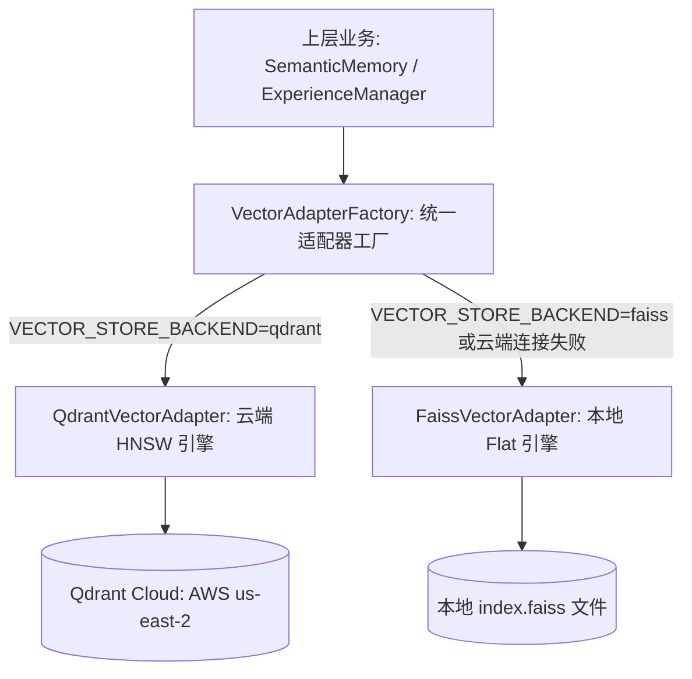

# Qdrant Cloud 向量存储双引擎接入设计规范 (Spec)

> **设计日期**：2026-11-02  
> **文档位置**：`docs/superpowers/specs/2026-11-02-qdrant-cloud-integration-design.md`  
> **设计模式**：Matt Pocock 深模块原则 (Deep Modules) + 适配器模式 (Adapter Pattern) + 优雅容灾降级 (Graceful Fallback)

---

## 1. 目标与背景

当前 Argus-Agent 项目在长效认知记忆（`SemanticMemory`）和经验案例库（`ExperienceManager`）中依赖本地文件系统的 FAISS 索引。为了支持分布式云端部署、多 Worker 实例共享记忆库以及单阶段 Payload 结构化元数据过滤，本项目引入 **Qdrant Cloud 向量数据库** 作为生产级向量后端。

同时，为确保离线测试、断网环境及本地 CI/CD 流水线的 100% 稳定性，系统采用**双引擎适配器模式**，当 Qdrant 服务异常或未配置时自动降级至本地 FAISS。

---

## 2. 架构设计与模块分层



### 2.1 模块职责划分

1. **`app/memory/qdrant_vector_adapter.py`**（深模块，窄接口）：
   - 封装 `qdrant_client.QdrantClient` 连接池与重试逻辑；
   - 封装集合自动创建与 HNSW 索引调优（`m=32, ef_construct=256, search_ef=128`）；
   - 对齐现有的四大约束方法：
     - `has_index(storage_path: str) -> bool`
     - `add_documents(storage_path: str, embeddings: Any, docs: List[Document]) -> bool`
     - `search_with_score(storage_path: str, embeddings: Any, query: str, k: int = 4) -> List[Tuple[Document, float]]`
     - `delete_documents(storage_path: str, ids: List[str]) -> bool`
   - 将本地路径形式的 `storage_path`（如 `data/memory_v2`）规范化转换为 Qdrant 合法的 Collection Name（如 `argus_memory_v2`）。

2. **`app/memory/vector_adapter_factory.py`**（适配器工厂）：
   - 统一入口函数 `get_vector_adapter()`；
   - 检查环境变量 `VECTOR_STORE_BACKEND`：
     - 若为 `qdrant`，尝试获取 `qdrant_vector_adapter` 单例；
     - 若 Qdrant 客户端未安装、鉴权失败或网络超时，记录 `logger.warning` 并自动回退至 `faiss_vector_adapter`，确保主流程永不阻塞；
     - 若为 `faiss`，直接返回 `faiss_vector_adapter`。

3. **调用端改造**：
   - [`app/memory/semantic_memory.py`](file:///f:/chain/argus-agent/app/memory/semantic_memory.py)
   - [`app/memory/experience.py`](file:///f:/chain/argus-agent/app/memory/experience.py)
   - 将直接引用的 `faiss_vector_adapter` 替换为 `from app.memory.vector_adapter_factory import get_vector_adapter`。

---

## 3. 详细设计与实现细节

### 3.1 路径与 Collection 映射策略
Qdrant 集合名称只允许包含字母、数字、下划线和短横线。映射函数：
```python
def path_to_collection_name(storage_path: str) -> str:
    cleaned = storage_path.replace("\\", "/").strip("/").replace("/", "_")
    return f"argus_{cleaned}"
```
示例：
- `data/memory_v2` $\rightarrow$ `argus_data_memory_v2`
- `store/experiences` $\rightarrow$ `argus_store_experiences`

### 3.2 HNSW 索引与距离度量契约
- **距离度量**：默认 `models.Distance.COSINE`。
- **HNSW 配置**：
  ```python
  models.HnswConfigDiff(
      m=32,
      ef_construct=256
  )
  ```
- **搜索参数**：
  ```python
  models.SearchParams(
      hnsw_ef=128,
      exact=False
  )
  ```

### 3.3 容灾与降级矩阵 (Graceful Degradation)

| 场景 | 系统响应 | 降级行为 |
| :--- | :--- | :--- |
| `VECTOR_STORE_BACKEND=qdrant` 且连接正常 | 正常使用 Qdrant 写入/检索 | 走云端 HNSW |
| `qdrant-client` 异常或网络断开 | 捕获异常，输出 Warning 日志 | 无缝回退至本地 FAISS 写入/检索 |
| `QDRANT_API_KEY` 或 `QDRANT_URL` 未配置 | 识别未就绪状态 | 直接走本地 FAISS |
| `VECTOR_STORE_BACKEND=faiss` | 显式声明使用本地方案 | 走本地 FAISS |

---

## 4. 验证与测试方案

1. **真实云实例连通性测试**：
   - 针对当前已配置在 `.env` 中的 `https://ccabfd3a-0730-4f1a-9742-bae5cef9fbb4.us-east-2-0.aws.cloud.qdrant.io` 执行自动化集成测试。
2. **单元测试矩阵 (`tests/unit/test_qdrant_vector_adapter.py`)**：
   - `test_qdrant_add_and_search`：插入 2 条 `Document` 并执行相似度检索，断言得分高于阈值且元数据无损；
   - `test_qdrant_collection_naming`：测试路径向 Collection 名称的安全转换；
   - `test_factory_fallback_on_error`：模拟无效 Qdrant 连接时，验证工厂是否正确回退至 FAISS 且主流程无异常抛出。
