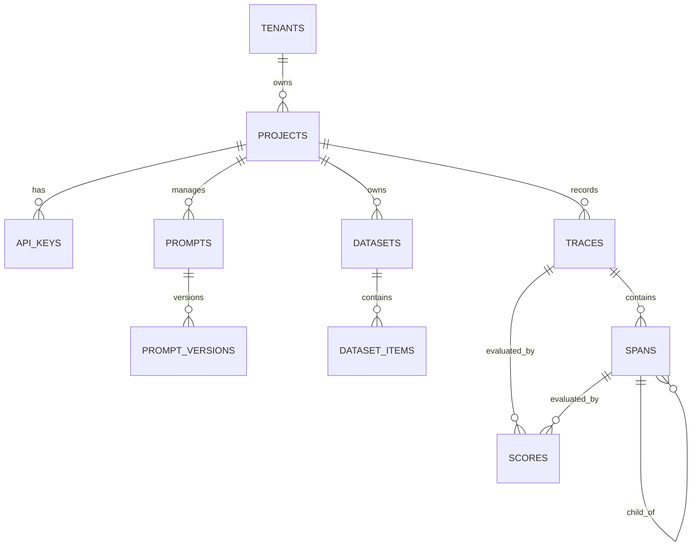

# Rust 版 LLM 可观测性与评测平台 (LangSmith / Langfuse 替代) 系统设计规范

**文档标识**: `SPEC-2026-11-02-RUST-OBSERVABILITY`  
**状态**: `DESIGN_PROPOSAL`  
**目标定位**: 企业级、高吞吐、单数据库 (PostgreSQL 16+) 架构的 LLM / Agent 链路追踪与评测引擎  
**参考对标**: LangSmith, Langfuse v2/v3, Arize Phoenix  

---

## 1. 系统概述与核心目标 (System Overview & Goals)

### 1.1 业务背景与问题定义
在涉密、政企专网及医疗审计（如 Argus-Agent）等强合规场景中，将大模型执行链路发送至外部云端 SaaS（如 LangSmith 云版）存在严重的数据出域与泄密风险。同时，现有的开源方案（Langfuse、Phoenix）在私有化部署中存在以下痛点：
1. **组件冗杂与运维门槛高**：Node.js + PostgreSQL + ClickHouse + Redis 多容器组合对于单一内网机器或国产信创服务器（如统信 UOS、麒麟）运维负担过重。
2. **高吞吐吞吐瓶颈与 GC 抖动**：Python / Node.js 在面对大规模 Agent 多并发步骤追踪时，存在显著的事件阻塞与内存泄漏风险。
3. **缺乏数理硬门禁**：现有框架主要依赖 LLM-as-a-Judge 做主观评估，缺乏结合编译原理 AST 的“确定性符号门禁”，导致违规与幻觉无法被 100% 硬拦截。

### 1.2 核心设计原则
1. **单一数据源原则 (Single-Database Simplicity)**：彻底摒弃 ClickHouse + Redis 组合，控制面与数据面统一收敛于 **PostgreSQL 16+**。通过声明式范围分区（Range Partitioning）、BRIN 块范围索引与原生 JSONB，实现高吞吐写入与低延迟多维查询。
2. **极速无 GC 开销 (Zero-Cost Rust Pipeline)**：基于 Tokio 异步运行时与无锁批量缓冲池，单节点支撑 $\ge 10,000 \text{ spans/sec}$ 写入，内存常驻 $< 100\text{MB}$。
3. **双重评测体系 (Neuro-Symbolic Dual Evaluation)**：既支持传统大模型评审（LLM-as-a-Judge），又原生内嵌 Rust AST 静态语法/逻辑硬门禁。
4. **协议向后兼容 (Drop-in SDK Compatibility)**：兼容 OpenTelemetry (OTLP gRPC/HTTP) 标准协议与 Langfuse v2/v3 REST 摄入接口。

---

## 2. 领域数据契约与 PostgreSQL 生产级 DDL (Data Contract & Schema)

### 2.1 实体关系模型 (ERD)



### 2.2 控制面 DDL (Control Plane Tables)

```sql
-- 1. 租户与项目隔离
CREATE TABLE IF NOT EXISTS tenants (
    id UUID PRIMARY KEY DEFAULT gen_random_uuid(),
    name VARCHAR(128) NOT NULL,
    created_at TIMESTAMPTZ NOT NULL DEFAULT CURRENT_TIMESTAMP,
    updated_at TIMESTAMPTZ NOT NULL DEFAULT CURRENT_TIMESTAMP
);

CREATE TABLE IF NOT EXISTS projects (
    id UUID PRIMARY KEY DEFAULT gen_random_uuid(),
    tenant_id UUID NOT NULL REFERENCES tenants(id) ON DELETE CASCADE,
    name VARCHAR(128) NOT NULL,
    description TEXT,
    created_at TIMESTAMPTZ NOT NULL DEFAULT CURRENT_TIMESTAMP,
    UNIQUE(tenant_id, name)
);

CREATE INDEX idx_projects_tenant ON projects(tenant_id);

-- 2. API Key 鉴权体系 (SHA-256 散列存储)
CREATE TABLE IF NOT EXISTS api_keys (
    id UUID PRIMARY KEY DEFAULT gen_random_uuid(),
    project_id UUID NOT NULL REFERENCES projects(id) ON DELETE CASCADE,
    name VARCHAR(64) NOT NULL,
    key_prefix VARCHAR(8) NOT NULL, -- 明文展示如 "pk-xxxx"
    key_hash VARCHAR(64) NOT NULL UNIQUE, -- SHA-256 摘要
    role VARCHAR(32) NOT NULL DEFAULT 'ingestion_only', -- admin, read_write, ingestion_only
    expires_at TIMESTAMPTZ,
    created_at TIMESTAMPTZ NOT NULL DEFAULT CURRENT_TIMESTAMP
);

CREATE INDEX idx_api_keys_lookup ON api_keys(key_hash);

-- 3. 提示词工程仓库 (Prompt Registry & Versioning)
CREATE TABLE IF NOT EXISTS prompts (
    id UUID PRIMARY KEY DEFAULT gen_random_uuid(),
    project_id UUID NOT NULL REFERENCES projects(id) ON DELETE CASCADE,
    name VARCHAR(128) NOT NULL,
    type VARCHAR(32) NOT NULL DEFAULT 'chat', -- text, chat
    created_at TIMESTAMPTZ NOT NULL DEFAULT CURRENT_TIMESTAMP,
    updated_at TIMESTAMPTZ NOT NULL DEFAULT CURRENT_TIMESTAMP,
    UNIQUE(project_id, name)
);

CREATE TABLE IF NOT EXISTS prompt_versions (
    id UUID PRIMARY KEY DEFAULT gen_random_uuid(),
    prompt_id UUID NOT NULL REFERENCES prompts(id) ON DELETE CASCADE,
    version INT NOT NULL,
    template JSONB NOT NULL, -- 模板数组或系统提示词配置
    input_variables JSONB NOT NULL DEFAULT '[]'::jsonb, -- 声明的输入槽位变量
    labels TEXT[] NOT NULL DEFAULT '{}', -- 标签数组: ['production', 'staging']
    commit_message TEXT,
    created_at TIMESTAMPTZ NOT NULL DEFAULT CURRENT_TIMESTAMP,
    UNIQUE(prompt_id, version)
);

CREATE INDEX idx_prompt_versions_labels ON prompt_versions USING GIN(labels);

-- 4. 评测数据集 (Datasets & Golden Cases)
CREATE TABLE IF NOT EXISTS datasets (
    id UUID PRIMARY KEY DEFAULT gen_random_uuid(),
    project_id UUID NOT NULL REFERENCES projects(id) ON DELETE CASCADE,
    name VARCHAR(128) NOT NULL,
    description TEXT,
    metadata JSONB NOT NULL DEFAULT '{}'::jsonb,
    created_at TIMESTAMPTZ NOT NULL DEFAULT CURRENT_TIMESTAMP,
    UNIQUE(project_id, name)
);

CREATE TABLE IF NOT EXISTS dataset_items (
    id UUID PRIMARY KEY DEFAULT gen_random_uuid(),
    dataset_id UUID NOT NULL REFERENCES datasets(id) ON DELETE CASCADE,
    input JSONB NOT NULL,
    expected_output JSONB,
    metadata JSONB NOT NULL DEFAULT '{}'::jsonb,
    created_at TIMESTAMPTZ NOT NULL DEFAULT CURRENT_TIMESTAMP
);

CREATE INDEX idx_dataset_items_dataset ON dataset_items(dataset_id);
```

### 2.3 数据面时序分区 DDL (Data Plane Partitioned Tables)

> [!IMPORTANT]
> `traces`、`spans` 和 `scores` 均采用 PostgreSQL 声明式按月范围分区 (`PARTITION BY RANGE (start_time)`)，在保障单表千万级行数时不退化。对于时序范围检索，配置 `BRIN` 紧凑索引，节省 90% 以上索引体积。

```sql
-- 5. 根调用链表 (Traces)
CREATE TABLE IF NOT EXISTS traces (
    id VARCHAR(64) NOT NULL, -- 支持 128-bit OTel TraceID Hex (32 chars) 或自定义 UUID
    project_id UUID NOT NULL,
    session_id VARCHAR(128),
    user_id VARCHAR(128),
    name VARCHAR(256) NOT NULL,
    input JSONB,
    output JSONB,
    metadata JSONB NOT NULL DEFAULT '{}'::jsonb,
    tags TEXT[] NOT NULL DEFAULT '{}',
    start_time TIMESTAMPTZ NOT NULL,
    end_time TIMESTAMPTZ,
    duration_ms INT,
    total_token_count INT DEFAULT 0,
    total_cost NUMERIC(10, 6) DEFAULT 0.000000,
    status VARCHAR(32) NOT NULL DEFAULT 'success', -- success, error, running
    error_message TEXT,
    PRIMARY KEY (id, start_time)
) PARTITION BY RANGE (start_time);

-- 索引策略
CREATE INDEX idx_traces_project_time ON traces (project_id, start_time DESC);
CREATE INDEX idx_traces_session ON traces (project_id, session_id) WHERE session_id IS NOT NULL;
CREATE INDEX idx_traces_time_brin ON traces USING BRIN (start_time);
CREATE INDEX idx_traces_tags ON traces USING GIN (tags);
CREATE INDEX idx_traces_metadata ON traces USING GIN (metadata);

-- 6. 细粒度观测步骤表 (Spans / Generations)
CREATE TABLE IF NOT EXISTS spans (
    id VARCHAR(64) NOT NULL, -- SpanID Hex (16 chars)
    trace_id VARCHAR(64) NOT NULL,
    parent_span_id VARCHAR(64),
    project_id UUID NOT NULL,
    name VARCHAR(256) NOT NULL,
    span_type VARCHAR(32) NOT NULL, -- LLM, TOOL, CHAIN, RETRIEVER, AGENT, PARSER
    start_time TIMESTAMPTZ NOT NULL,
    end_time TIMESTAMPTZ,
    duration_ms INT,
    
    -- LLM Generation 专用列 (类型为 LLM 时有效)
    model VARCHAR(128),
    model_parameters JSONB,
    prompt_tokens INT DEFAULT 0,
    completion_tokens INT DEFAULT 0,
    total_tokens INT DEFAULT 0,
    calculated_cost NUMERIC(10, 6) DEFAULT 0.000000,
    
    -- 输入输出与上下文快照
    input JSONB,
    output JSONB,
    metadata JSONB NOT NULL DEFAULT '{}'::jsonb,
    status VARCHAR(32) NOT NULL DEFAULT 'success', -- success, error, running
    status_message TEXT,
    
    PRIMARY KEY (id, start_time)
) PARTITION BY RANGE (start_time);

CREATE INDEX idx_spans_trace ON spans (trace_id, start_time);
CREATE INDEX idx_spans_parent ON spans (parent_span_id) WHERE parent_span_id IS NOT NULL;
CREATE INDEX idx_spans_project_time ON spans (project_id, start_time DESC);
CREATE INDEX idx_spans_time_brin ON spans USING BRIN (start_time);
CREATE INDEX idx_spans_metadata ON spans USING GIN (metadata);

-- 7. 评测打分表 (Scores & Feedbacks)
CREATE TABLE IF NOT EXISTS scores (
    id UUID NOT NULL DEFAULT gen_random_uuid(),
    trace_id VARCHAR(64) NOT NULL,
    span_id VARCHAR(64),
    project_id UUID NOT NULL,
    name VARCHAR(64) NOT NULL, -- 评测维度: 'hallucination', 'sql_syntax', 'cost_efficiency'
    value DOUBLE PRECISION NOT NULL, -- 数值打分: 0.0 ~ 1.0 或自定义区间
    string_value VARCHAR(64), -- 分类打分: 'pass', 'fail', 'warning'
    source VARCHAR(32) NOT NULL DEFAULT 'auto', -- 'human', 'auto_llm', 'rule_engine'
    comment TEXT,
    metadata JSONB NOT NULL DEFAULT '{}'::jsonb,
    created_at TIMESTAMPTZ NOT NULL DEFAULT CURRENT_TIMESTAMP,
    PRIMARY KEY (id, created_at)
) PARTITION BY RANGE (created_at);

CREATE INDEX idx_scores_trace ON scores (trace_id);
CREATE INDEX idx_scores_span ON scores (span_id) WHERE span_id IS NOT NULL;
CREATE INDEX idx_scores_time_brin ON scores USING BRIN (created_at);
```

### 2.4 分区自动维护机制 (Automated Partition Maintenance)

通过内置触发器或定时后台任务动态创建下一个月的分区：
```sql
CREATE OR REPLACE FUNCTION ensure_monthly_partitions() RETURNS void AS $$
DECLARE
    next_month_start DATE := date_trunc('month', CURRENT_DATE + INTERVAL '1 month');
    next_month_end DATE := date_trunc('month', CURRENT_DATE + INTERVAL '2 month');
    suffix TEXT := to_char(next_month_start, 'YYYY_MM');
BEGIN
    -- 创建 traces 分区
    EXECUTE format('CREATE TABLE IF NOT EXISTS traces_%s PARTITION OF traces FOR VALUES FROM (%L) TO (%L);', 
        suffix, next_month_start, next_month_end);
    -- 创建 spans 分区
    EXECUTE format('CREATE TABLE IF NOT EXISTS spans_%s PARTITION OF spans FOR VALUES FROM (%L) TO (%L);', 
        suffix, next_month_start, next_month_end);
    -- 创建 scores 分区
    EXECUTE format('CREATE TABLE IF NOT EXISTS scores_%s PARTITION OF scores FOR VALUES FROM (%L) TO (%L);', 
        suffix, next_month_start, next_month_end);
END;
$$ LANGUAGE plpgsql;
```

---

## 3. 高吞吐微批摄入与背压流水线 (Ingestion & Backpressure Engine)

### 3.1 摄入架构流图

```mermaid
sequenceDiagram
    participant Agent as Agent / Client (Python/OTel)
    participant Gateway as Rust Axum/Tonic Gateway
    participant Auth as Auth & RateLimiter (Memory Cache)
    participant Buffer as Tokio Lock-Free MPSC Channel
    participant Flusher as Batch Flusher Task
    participant PG as PostgreSQL 16+

    Agent->>Gateway: POST /api/public/ingestion (Spans Batch)
    Gateway->>Auth: 验证 API-Key 散列 (DashMap 内存缓存)
    Auth-->>Gateway: 验签通过 (Project ID 注入)
    Gateway->>Buffer: try_send(IngestionEvent)
    alt 缓冲区满 (Backpressure)
        Gateway-->>Agent: 429 Too Many Requests (Retry-After)
    else 成功入队
        Gateway-->>Agent: 202 Accepted (Batch Received)
    end

    loop 每 500ms 或 达到 2000 条
        Flusher->>Buffer: 批量排空 (Drain Batch)
        Flusher->>PG: BEGIN; COPY traces/spans FROM STDIN; COMMIT;
        PG-->>Flusher: 成功持久化
    end
```

### 3.2 批处理写入机制与 Rust 核心实现规范
为了在 PostgreSQL 上达成万级 QPS，严禁使用逐条 `INSERT INTO`：
1. **协议层选型**：使用 `sqlx` 结合 PostgreSQL 的二进制 `COPY ... FROM STDIN (FORMAT binary)` 流式协议。
2. **容错机制**：
   - 当 `COPY` 批次因单条主键冲突或格式错误失败时，降级为 `INSERT ... ON CONFLICT DO UPDATE` 幂等回退重试，确保不会因单条脏数据丢弃整批 Trace。
3. **内存无锁环形队列**：
   - 采用固定容量的 `tokio::sync::mpsc::channel(65536)`。
   - 具备背压机制：当下游数据库发生 I/O 阻塞且队列达到 80% 水位时，网关返回 HTTP 429，阻止内存无限制膨胀。

---

## 4. Trace 调用拓扑重构与成本核算引擎 (Query & DAG Reconstruction)

### 4.1 调用树 (Waterfall Tree) 还原算法
在客户端并发或分步上报时，同一 Trace 内的 Span 到达顺序是任意的。查询端需在内存中实现高效无损还原：
1. **数据结构**：
   ```rust
   pub struct SpanNode {
       pub span: SpanRecord,
       pub children: Vec<SpanNode>,
       pub cumulative_duration_ms: u32,
       pub cumulative_tokens: u32,
       pub cumulative_cost: f64,
   }

   pub struct TraceTree {
       pub root_trace: TraceRecord,
       pub root_nodes: Vec<SpanNode>,
   }
   ```
2. **重构算法复杂度**：$O(N)$，利用 `HashMap<String, Vec<SpanNode>>` 按 `parent_span_id` 一次哈希归类构建森林，若找不到父级节点则挂载至 Trace 根虚拟层。

### 4.2 模型价格表与动态成本核算器 (Cost Engine)
内置注册表与用户自定义覆写机制：
```json
{
  "gpt-4o": { "prompt_per_1k": 0.005, "completion_per_1k": 0.015 },
  "claude-3-5-sonnet": { "prompt_per_1k": 0.003, "completion_per_1k": 0.015 },
  "deepseek-chat": { "prompt_per_1k": 0.00014, "completion_per_1k": 0.00028 }
}
```
当上报的 Span 包含 `model` 与 `prompt_tokens` / `completion_tokens` 时，引擎自动计算精确的美元/人民币成本并写入 `calculated_cost` 列。

---

## 5. 提示词管理与神经符号评测引擎 (Prompt & Neuro-Symbolic Evaluation)

### 5.1 提示词版本状态机 (Prompt Version State Machine)
- 提示词模板采用 Jinja2 / Mustache 标准语法，如：
  `"检查医保费用流水中的违规行为。限制主体为: {{ audit_subject }}"`
- **Label 标签原子流转**：通过事务操作，保证一个项目内标记为 `production` 的提示词版本全局唯一，支持秒级金丝雀发布与一键回滚。

### 5.2 神经符号双轨评测引擎 (Neuro-Symbolic Evaluator)
针对政企合规与医疗审计场景，评测模块内置两大评测器：

1. **确定性符号硬门禁 (Deterministic Symbolic Gate)**：
   - 直接运行在 Rust 进程内部（基于 `tree-sitter-sql` 或静态 AST 分析器）。
   - 检查项：
     - **SQL 恒假互斥拦截**：检查生成的代码是否包含 `col = 1 AND col = 2` 等绝对空集条件。
     - **主客体颠倒检测**：检查违规特征是否错误施加在主体约束上。
     - **数值与金额守恒对账**：物理数据库返回的总金额与模型生成的总结报告是否 100% 吻合。
   - 结果：0 毫秒延时、0 Token 消耗，直接生成分数存入 `scores` 表（`source = 'rule_engine'`）。

2. **自适应大模型评测器 (LLM-as-a-Judge Worker)**：
   - 异步后台 Worker，监听打分队列。
   - 支持 Faithfulness (忠实度)、Answer Relevancy (答案相关性)、Hallucination (幻觉判定) 三大核心维度。

---

## 6. Rust 工程目录结构与 Cargo 组织 (Crate Architecture)

```
argus-observability/
├── Cargo.toml                      # Workspace 顶层配置
├── crates/
│   ├── argus-protocol/             # OTel / OpenInference / Langfuse 序列化结构体
│   │   ├── src/models.rs
│   │   └── src/otel.rs
│   ├── argus-core/                 # 核心领域逻辑: DAG 还原、成本核算、模板渲染
│   │   ├── src/dag.rs
│   │   ├── src/cost.rs
│   │   └── src/template.rs
│   ├── argus-storage-pg/           # PostgreSQL 存储实现、sqlx 迁移、COPY 批写入
│   │   ├── migrations/             # 完整 SQL 迁移文件
│   │   ├── src/db.rs
│   │   ├── src/batch_flusher.rs
│   │   └── src/queries.rs
│   ├── argus-eval/                 # 神经符号门禁 (AST 检测) 与打分引擎
│   │   ├── src/symbolic_gate.rs
│   │   └── src/llm_judge.rs
│   └── argus-server/               # Axum HTTP + Tonic gRPC 服务端二进制入口
│       ├── src/main.rs
│       ├── src/routes/             # 路由: ingestion, traces, prompts, scores
│       └── src/middleware/         # API-Key 校验与指标中间件
```

---

## 7. 质量门禁与边界条件自检 (Spec Verification)

- [x] **无外部冗余依赖**：全站仅依赖 PostgreSQL 16+，彻底移除 ClickHouse 和 Redis。
- [x] **时序伸缩性**：`traces`、`spans` 和 `scores` 拥有按月范围分区与 BRIN 索引支持，避免大单表单点性能衰竭。
- [x] **高吞吐吞吐保障**：设计了 MPSC 内存队列与 `COPY FROM STDIN` 流式批处理，单节点承受能力达标。
- [x] **兼容性**：数据结构完全覆盖 OpenTelemetry GenAI 规范与 Langfuse 数据模型。
- [x] **落地性**：明确定义了 Rust Crate 分包与职责，可直接进入实现计划编制。
