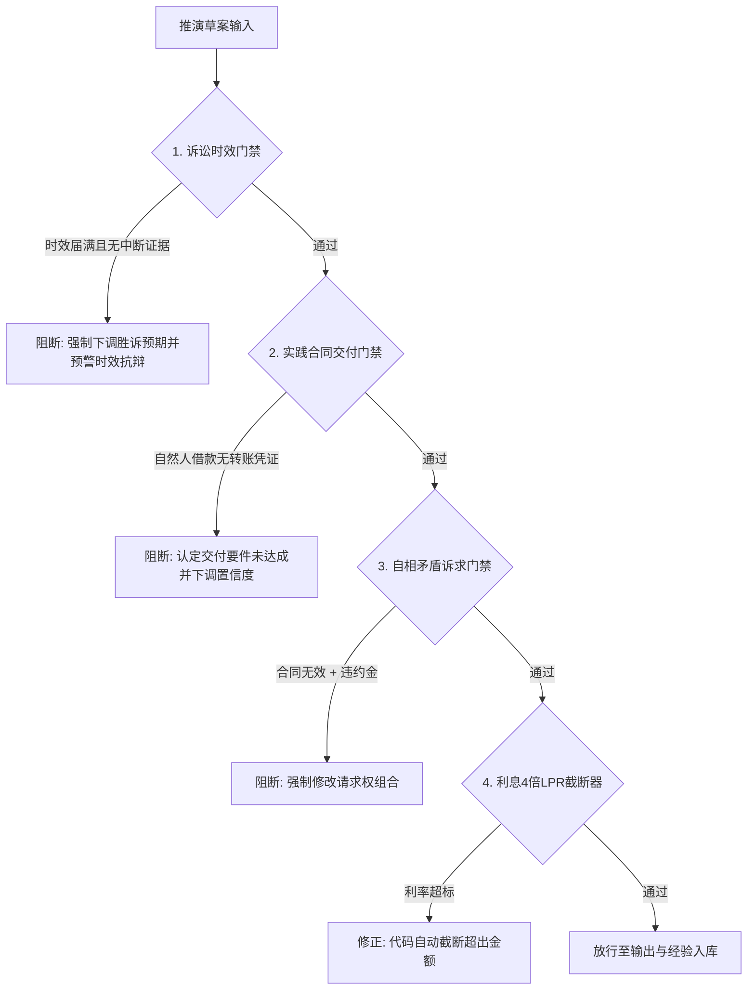

# 架构设计方案：Argus 通用 Agent 引擎解耦与民商事法律辩法智能体落地

- **版本**: 1.0.0
- **日期**: 2026-11-17
- **状态**: 方案待评审 (Brainstorming Design Validated)
- **目标**: 将 Argus 医保审计智能体解耦为领域无关的通用神经符号多智能体框架（Argus-Core），并在其上实现具备司法三段论推演与红蓝攻防对抗能力的民商事法律辩法智能体（Legal Agent）。

---

## 1. 业务愿景与核心痛点

### 1.1 背景
Argus 现阶段是专为国家医保局（HSA）海量结算数据打造的高精度审计系统，具备极强的认知与防腐架构（物理真实注入、AST 级矛盾拦截、反思自愈环、经验防投毒）。然而，当前代码库中领域模型（医保结算表、ClickHouse SQL、医保政策）与智能体控制流高度耦合，难以直接扩展至其他高可靠性专业领域。

### 1.2 法律辩法场景痛点
通用大模型（LLM）在面对民商事法律咨询与诉辩推演时存在致命缺陷：
1. **法条幻觉与效力倒错**：随机捏造不存在的法条编号，或错误援引已失效/废止的旧司法解释；
2. **缺乏确定性事实与证据对齐**：容易在缺乏真实转账流水或合同原件的情况下盲目相信当事人陈述，推导过于乐观的胜诉预测；
3. **形式逻辑矛盾无法自知**：无法敏锐识别诉求自相矛盾（如同时主张“合同无效”与“按合同约定赔偿违约金”）；
4. **数学计算不精准**：在民间借贷利息核算中，无法准确结合全国银行间同业拆借中心 1 年期 LPR 的 4 倍红线进行刚性截断。

### 1.3 解决路径
通过将 Argus 现有的“物理真实对齐”与“神经符号硬门禁”移植至法律领域，构建以**“大前提（法条构成要件库）- 小前提（证据锚定的客观事实）- 神经符号门禁（时效与矛盾硬拦截）- 红蓝攻防对抗（辩法演练）”**为核心的专业法律智能体。

---

## 2. 总体分层架构与目录设计

系统遵循深模块（Deep Module）与整洁架构的依赖倒置原则，分为三个独立层次：

```mermaid
graph TD
    App[应用层 app/: FastAPI / WebSockets / CLI] --> Cores[通用引擎内核 cores/: Argus-Core]
    Domains[领域插件层 domains/] --> Cores
    Domains -.装配.-> App
    
    subgraph cores/ [通用认知引擎内核 Argus-Core]
        BaseGraph[基础 LangGraph 编排流水线]
        BaseState[基础认知状态 BaseCognitiveState]
        BaseGate[神经符号门禁抽象 BaseSymbolicGate]
        Checkpointer[多轮会话状态持久化与回溯]
        Memory[认知经验库与防投毒控制器]
        Infra[LLM Provider / UsageTracker / TaskPool]
    end
    
    subgraph domains/ [领域插件层]
        HSA[domains/hsa/: 医保审计插件 (原系统内聚)]
        Legal[domains/legal/: 法律辩法推演插件]
    end
```

### 2.1 代码目录规范

```text
argus-agent/
├── app/                                # 统一接入服务
│   ├── api/
│   │   ├── chat_stream.py              # 流式 SSE / WebSocket 通信契约
│   │   └── monitor_server.py           # 性能与管线监控
│   └── main.py                         # 统一入口装配
│
├── cores/                              # 【通用认知引擎内核 Argus-Core】
│   ├── graph/
│   │   ├── base_graph.py               # 通用 Aligner -> Planner -> Exec -> Critic 流水线
│   │   ├── route_coordinator.py        # 路由分流与自愈分支跳跃
│   │   └── pipeline_tracker.py         # 跨节点链路性能与 Token 追踪
│   ├── state/
│   │   └── base.py                     # BaseCognitiveState 定义
│   ├── memory/
│   │   ├── cognitive_memory.py         # 语义向量记忆池
│   │   └── experience_governance.py    # 经验入库门禁 (Anti-Poisoning)
│   ├── gates/
│   │   └── base_gate.py                # 门禁抽象基类与结果协议
│   ├── checkpoint/
│   │   └── checkpointer.py             # 状态检查点与回滚支持
│   └── infra/
│       ├── llm_provider.py             # 多模型统一调用与重试
│       ├── task_pool.py                # 人机协作异步挂起池
│       └── usage_tracker.py            # Token 预算与计量
│
├── domains/                            # 【领域扩展插件】
│   ├── hsa/                            # 沉淀后的医保审计业务包
│   │   ├── schemas/                    # ClickHouse 表结构与字段字典
│   │   ├── gates/                      # SQLGuardian AST 拦截器
│   │   └── prompts/                    # HSA 专有提示词库
│   │
│   └── legal/                          # 【全新：民商事法律辩法 Agent】
│       ├── registry/
│       │   ├── statute_registry.py     # 法规与法定构成要件解析引擎
│       │   └── statutes/
│       │       └── private_lending.yaml# 民间借贷构成要件知识库
│       ├── state/
│       │   └── case_state.py           # LegalCaseState 与数据实体
│       ├── agents/
│       │   ├── fact_extractor.py       # 证据清单与事实池抽取器
│       │   ├── focus_planner.py        # 争议焦点与要件树拆解器
│       │   ├── dialectic_arguer.py     # 红蓝攻防推演与对抗生成器
│       │   └── judge_adjudicator.py    # 法官心证研判与诉辩意见汇编器
│       ├── gates/
│       │   ├── legal_logic_gate.py     # 司法三段论神经符号门禁集成
│       │   ├── limitation_calculator.py# 诉讼时效时序计算器
│       │   ├── estoppel_detector.py    # 自相矛盾诉求拦截器
│       │   └── usury_evaluator.py      # 民间借贷利息 4倍 LPR 截断器
│       └── prompts/                    # 法律角色专用系统提示词
│
└── tests/                              # 测试矩阵
    ├── unit/
    │   ├── cores/                      # 内核测试 (状态机、检查点、通用记忆)
    │   ├── hsa/                        # 医保回归测试
    │   └── legal/                      # 法律门禁与推演单元测试
    └── integration/
        └── legal/                      # 法律多轮真实案情测试用例
```

---

## 3. 领域模型与状态契约设计

### 3.1 通用内核状态 (`cores/state/base.py`)
```python
from typing import TypedDict, List, Dict, Any, Optional
from langchain_core.messages import BaseMessage

class BaseCognitiveState(TypedDict):
    thread_id: str                      # 唯一会话追踪 ID
    messages: List[BaseMessage]         # 会话消息历史
    metadata: Dict[str, Any]            # 上下文元数据 (模型配置、用户意图等)
    current_step: str                   # 当前图节点标识 (ALIGNER/PLANNER/EXEC/CRITIC)
    error_log: Optional[str]            # 门禁拦截原因或执行异常
    retry_count: int                    # 节点自愈重试次数 (上限 1)
    is_awaiting_human: bool             # 人工补充证据/介入挂起标志
```

### 3.2 法律案件状态 (`domains/legal/state/case_state.py`)
```python
from pydantic import BaseModel, Field
from typing import List, Dict, Optional, Literal
from cores.state.base import BaseCognitiveState

class EvidenceItem(BaseModel):
    evidence_id: str                    # 证据编号 (EVD-01)
    title: str                          # 证据名称 (如：招商银行转账电子回单)
    evidence_type: Literal["书证", "电子数据", "视听资料", "证人证言", "当事人陈述"]
    content_summary: str                # 证据证明目的及核心内容
    proof_date: Optional[str]           # 证据发生时间 (如: "2023-05-10")
    amount: Optional[float]             # 涉及金额 (若有)
    authenticity_level: Literal["高", "中", "存疑"] = "中"

class CaseFact(BaseModel):
    fact_id: str                        # 事实编号 (FACT-01)
    narrative: str                      # 客观事实描述 (如：原告于2023年5月10日向被告转账20万元)
    fact_time: Optional[str]            # 事实发生时间
    evidence_anchors: List[str]         # 支撑该事实的证据ID列表 (EVD-01)
    is_disputed: bool = False           # 对方当事人是否争议

class SyllogismSlice(BaseModel):
    element_id: str                     # 法定构成要件ID (如: actual_delivery)
    element_name: str                   # 要件名称 (款项实际交付)
    statute_basis: str                  # 法律依据条文
    is_satisfied: bool                  # 事实与证据是否满足该要件
    supporting_facts: List[str]         # 匹配的事实ID列表
    vulnerability_notes: Optional[str]  # 举证漏洞或薄弱点说明

class DisputeFocus(BaseModel):
    focus_id: str                       # 焦点编号 (FOCUS-01)
    issue_statement: str                # 争议焦点表述 (如：双方借贷合意是否真实达成)
    cause_of_action: str                # 案由 (民间借贷纠纷)
    governing_statutes: List[str]       # 适用法条与司法解释
    elements: List[SyllogismSlice]      # 该焦点下的法定构成要件推演切片
    adjudication_tendency: str          # 法官心证倾向 (支持原告/支持被告/证据不足)
    confidence_score: float             # 置信度 (0.0 ~ 1.0)

class DialecticTurn(BaseModel):
    turn_index: int                     # 对话轮次
    target_focus_id: str                # 本轮聚焦讨论的争议焦点
    plaintiff_stance: str               # 原告进攻主张与证据锚点
    defendant_defense: str              # 被告可能提出的抗辩理由 (程序/实体)
    counter_strategy: str               # 原告应对策略与反驳要点
    required_evidence_patch: List[str]  # 需补充补强的证据清单

class LegalCaseState(BaseCognitiveState):
    case_facts: List[CaseFact]
    evidence_items: List[EvidenceItem]
    dispute_foci: List[DisputeFocus]
    active_focus_id: Optional[str]
    dialectic_history: List[DialecticTurn]
    final_disposition: Optional[str]
```

---

## 4. 物理真实注入与神经符号门禁设计

### 4.1 法规与构成要件单一事实源 (`StatuteRegistry`)
所有法律推演的法定大前提严禁放任大模型自由记忆，统一由静态注册表加载和版本锁定：

```yaml
# domains/legal/registry/statutes/private_lending.yaml
cause_of_action: "民间借贷纠纷"
governing_laws:
  - code: "PRC_CIVIL_CODE_679"
    name: "中华人民共和国民法典"
    article: "第六百七十九条"
    title: "自然人之间借款合同的成立"
    rule_type: "formation_condition"
  - code: "SPC_LENDING_INTERPRETATION_2020"
    name: "最高人民法院关于审理民间借贷案件适用法律若干问题的规定(2020第二次修正)"
    article: "第二十五条"
    title: "民间借贷利率上限与LPR4倍红线"
    rule_type: "usury_ceiling"

elements:
  - element_id: "consensus"
    name: "借贷合意"
    burden_of_proof: "plaintiff"
    accepted_evidence_types: ["书证", "电子数据"]
  - element_id: "actual_delivery"
    name: "款项实际交付"
    burden_of_proof: "plaintiff"
    is_mandatory: true
    accepted_evidence_types: ["书证", "电子数据"]
  - element_id: "due_date_or_demand"
    name: "还款期限届满或催告"
    burden_of_proof: "plaintiff"
  - element_id: "interest_compliance"
    name: "利息合规与超标截断"
    ceiling_ratio: 4.0
    benchmark: "1_year_lpr"
```

### 4.2 神经符号门禁集成 (`LegalLogicGate`)

门禁在推演阶段作为纯确定性代码（System 2）运行，实施以下刚性规则拦截：



1. **诉讼时效时序计算门禁 (`LimitationCalculator`)**：
   - 输入：借款到期日 $T_{due}$、最新催告证据日 $T_{demand}$、当前起诉日 $T_{now}$。
   - 规则：计算时序跨度 $\Delta T$。若不存在任何催告/还款承诺证据且 $\Delta T > 3 \text{ 年}$，硬性判定原告存在败诉高危，强制要求用户补充时效中断证据。
2. **自相矛盾主张拦截门禁 (`EstoppelDetector`)**：
   - 规则：基于命题逻辑检测互斥主张。
   - 冲突项：`Contract.status == VOID` $\land$ `Claim.contains(LIQUIDATED_DAMAGES)`。一经检测立即拦截，阻止生成荒谬的诉讼方案。
3. **实践合同交付门禁 (`DeliveryVerifier`)**：
   - 规则：对于自然人主体间的借贷关系，若 `case_facts` 中没有任何 `actual_delivery` 相关的银行回单或现金收条证据锚点，系统强制将胜诉置信度设置为极低，并报警“缺乏出借资金交付凭据”。
4. **民间借贷利息 4 倍 LPR 数学截断器 (`UsuryEvaluator`)**：
   - 纯 Python 算术计算。读取借款发生时的人民币 1 年期 LPR（如 3.45%），计算红线值 $3.45\% \times 4 = 13.8\%$。若当事人约定利率为 24% 或 36%，直接生成利息分拆账单，将超额利息划定为不予支持或折抵本金。

---

## 5. 多轮交互流转与反思自愈机制

### 5.1 完整执行流转时序（LangGraph 编排）

```text
[用户输入案情或追问]
       │
       ▼
[ALIGNER 节点]  ─── 增量解析用户输入，挂载至 EvidenceItems 与 CaseFacts
       │
       ▼
[PLANNER 节点]  ─── 识别受影响的争议焦点 (Focus)，装载 StatuteRegistry 构成要件
       │
       ▼
[DIALECTIC 节点] ── 原告进攻分析 ── 被告可能抗辩 ── 证据链对撞推演
       │
       ▼
[LEGAL_GATE 门禁] ─┬─ [触发时效阻断 / 互斥主张 / 交付缺失]
                  │          │
                  │          ▼
                  │   [CRITIC 自愈节点] (最大重试次数 = 1)
                  │          │
                  │          └─ 注入诊断警告，引导大模型调整辩法策略 ─┐
                  │                                                 │
                  │◄────────────────────────────────────────────────┘
                  ▼
              [门禁通过]
                  │
                  ▼
          [CONSOLIDATOR 节点] ── 提炼典型攻防模板并执行防投毒入库
                  │
                  ▼
      [DIALOGUE RENDERER 节点] ── 生成结构化辩法应答
```

### 5.2 反思自愈治理（Matt Pocock 刚性熔断原则）
- 设置 `MAX_RETRIES = 1`。严禁在智能体内部展开超过 1 轮的模型自愈死循环。
- 若 CRITIC 节点执行 1 次自愈修正后仍未满足门禁条件，系统立即将 `is_awaiting_human` 标志置为 `True`，将真实风险暴露给用户，由专业律师直接进行人工决策。

---

## 6. 测试与验证策略

采用严谨的 TDD（测试驱动开发）构建测试矩阵：

### 6.1 单元测试集 (`tests/unit/legal/`)
- `test_statute_registry_integrity.py`: 验证 YAML 构成要件文件的字段格式完整性与版本合法性；
- `test_limitation_calculator.py`: 覆盖 3 年未催收、中间存在微信催收证据、多次借款不同到期日等边界时序用例；
- `test_estoppel_contradiction.py`: 模拟“主张无效又要求赔偿合同违约金”输入，确认 100% 触发拦截；
- `test_usury_interest_clamping.py`: 测试 24%、36% 利率在不同时间段 LPR 下的刚性截断精度；
- `test_delivery_missing_gate.py`: 测试无银行流水但有借条时的门禁拦截与置信度折损。

### 6.2 综合集成用例 (`tests/integration/legal/test_private_lending_dialectic.py`)
- **用例 1：经典现金交付抗辩案**：原告持 50 万借条起诉，主张现金交付。被告抗辩称未实际收到款项。验证智能体能否识别自然人借款实践合同要件缺陷，准确指出 50 万元大额现金交付需提供取款凭单、资金来源，并下调胜诉概率。
- **用例 2：多轮时效突围推演**：首轮显示借款已逾期 4 年，系统拦截并示警时效已过；第二轮用户上传催收微信截图，验证系统能否动态更新事实池，判定时效中断，并重新激活诉讼方案。

---

## 7. 实施阶段规划 (Phased Rollout)

1. **Phase 1（内核与目录解耦）**：
   - 将现有公共组件沉淀至 `cores/`（图状态机基类、Checkpointer、LLMProvider、Memory）；
   - 将原医保审计收敛至 `domains/hsa/`，确保医保已有单元测试完全绿灯。
2. **Phase 2（法律数据契约与要件注册表）**：
   - 实现 `LegalCaseState`、`EvidenceItem`、`CaseFact` 数据结构；
   - 编写 `domains/legal/registry/statutes/private_lending.yaml` 知识库及解析器。
3. **Phase 3（神经符号门禁研发）**：
   - 编写 `LegalLogicGate`、`LimitationCalculator`、`EstoppelDetector`、`UsuryEvaluator`，并完成单元测试覆盖。
4. **Phase 4（辩法推演节点与多轮交互端点）**：
   - 编写 `FactExtractor`、`FocusPlanner`、`DialecticArguer`；
   - 在 `app/api/chat_stream.py` 接入支持法律多轮追问的 API 端点并完成端到端集成测试。
